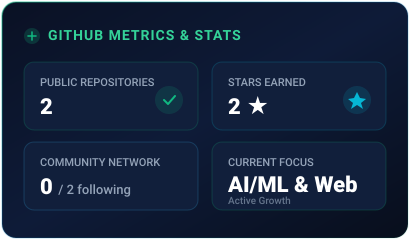
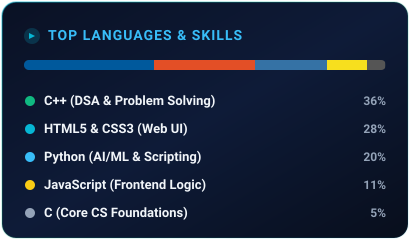
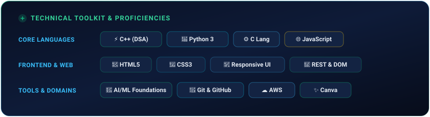
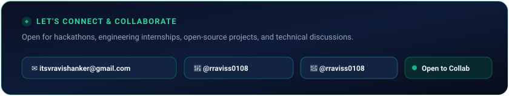

<div align="center">

<!-- 1. DYNAMIC HEADER & GREETING BANNER COMPONENT -->


<br/><br/>

<!-- QUICK BADGES & STATS -->
[](https://github.com/rraviss0108)
[](https://instagram.com/rraviss0108)
[](mailto:itsvravishanker@gmail.com)
[](https://github.com/rraviss0108)

</div>

<br/>

## 💫 About Me

```yaml
name: Ravi Shanker Umrao
degree: B.Tech in Computer Science & Engineering
focus_areas: [Artificial Intelligence, Machine Learning, Frontend Engineering]
current_learning: [Data Structures & Algorithms in C++, Modern Web Development]
hobbies: [Tech Exploration, UI/UX Crafting, Problem Solving]
status: Open to Internships, Hackathons & Open-Source Collaboration
```

---

## 📊 Analytics & Skill Distribution

<p align="center">
  <!-- 2. GITHUB STATS COMPONENT -->
  <a href="https://github.com/rraviss0108">
    
  </a>
  <!-- 3. TOP LANGUAGES & SKILLS COMPONENT -->
  
</p>

---

## 🚀 Featured Project Showcase

<p align="center">
  <!-- 4. FEATURED PROJECT SHOWCASE COMPONENT -->
  <a href="https://awsmse-five.vercel.app" target="_blank">
    
  </a>
</p>

> 💡 **Live Preview:** [awsmse-five.vercel.app](https://awsmse-five.vercel.app) • **Source Code:** [Indian-Festivals-and-Cultural-Heritage-Website](https://github.com/rraviss0108/Indian-Festivals-and-Cultural-Heritage-Website)

---

## 💻 Technical Toolkit & Proficiencies

<p align="center">
  <!-- 5. TECH STACK & TOOLKIT COMPONENT -->
  
</p>

---

## 📬 Let's Connect & Collaborate

<p align="center">
  <!-- 6. CONNECT & SOCIALS COMPONENT -->
  <a href="mailto:itsvravishanker@gmail.com">
    
  </a>
</p>

<div align="center">
  <sub>⚡ Designed with custom SVG Component Engine & GitHub Actions auto-refresh workflow. Crafted by <a href="https://github.com/rraviss0108"><b>@rraviss0108</b></a></sub>
</div>
